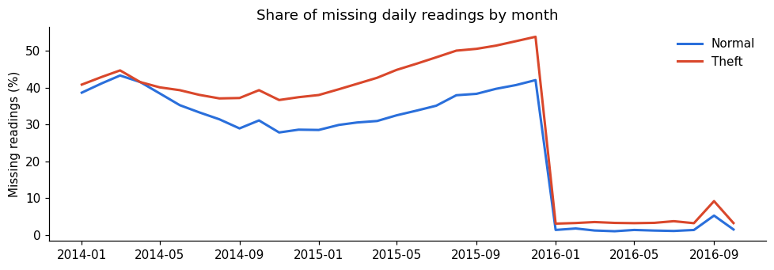

# Electricity theft detection from smart meter data

A practical data mining project on the SGCC dataset: getting the data, cleaning it, exploring it, reducing dimensions with PCA, and justifying one classifier (a random forest) for ranking customers by theft risk.

## Data

The SGCC dataset (State Grid Corporation of China) has daily kWh readings for 42,372 customers from 1 January 2014 to 31 October 2016. 3,615 of them (8.5%) are labelled as thieves. It was released with Zheng et al. (2018), *Wide and Deep Convolutional Neural Networks for Electricity-Theft Detection to Secure Smart Grids*, IEEE Transactions on Industrial Informatics 14(4), and is shared at [henryRDlab/ElectricityTheftDetection](https://github.com/henryRDlab/ElectricityTheftDetection).

On first run the notebook downloads the three zip parts (about 52 MB) into `data/sgcc/`. It then extracts the 175 MB CSV directly and checks its checksum, because standard unzip tools fail on this split archive. The data is not stored in this repository.

## Key findings

- **The missing values leak the label.** A classifier trained only on *which days are missing* reaches ROC-AUC 0.85, using no consumption data at all. The model is never given that pattern, but cleaning does not remove the leak: among the customers kept it still scores 0.87.
- **How much of the score could come from the gaps?**
    - On 8,206 customers with no week of more than 3 missing days, consumption scores ROC-AUC 0.780 and PR-AUC 0.241.
    - Random samples of the same size score 0.793 and 0.278, so a small part may come from the gaps.
    - The missing pattern alone still scores 0.794 there, so the shortcut cannot be ruled out with this dataset.
- **Filling method:** interpolating gaps (0.809) and skipping them (0.807) score almost the same. This does not show that the score is free of the leak.
- **Cleaning** (18,574 customers kept, 6.6% thieves):
    - keep customers with at most 10% missing and with readings on the first and last day;
    - fill gaps by straight-line interpolation;
    - cap each customer at their own 99th percentile (a mean plus 3 standard deviations cap left 50,910 kWh readings in place);
    - drop customers with almost no consumption and shuffle the rows.
- **PCA:** on 147 weekly shape values, 84 components are needed for 90% of the variance. The first 20 (58%) are used.
- **Model comparison** (5-fold CV on the 80% training customers only, 12 behaviour features plus 20 PCA components):

| Model | ROC-AUC | PR-AUC | Precision in top 5% |
|---|---|---|---|
| Random guess | 0.502 | 0.067 | 0.07 |
| Logistic regression | 0.742 | 0.228 | 0.28 |
| **Random forest** | **0.800** | **0.314** | **0.37** |
| Gradient boosting | 0.790 | 0.312 | 0.38 |

- **Test set** (3,715 customers set aside first): ROC-AUC 0.79 and PR-AUC 0.29. Flagging the top 5% (185 customers) finds 74 thieves, so 40.0% of visits find a thief against 6.6% for random visits.




## Run it

```bash
python -m venv .venv
source .venv/bin/activate
pip install -r requirements.txt
jupyter nbconvert --to notebook --execute electricity_theft.ipynb   # or open it in VS Code / Jupyter
```

Running the whole notebook takes a few minutes on a recent laptop, after the download.
