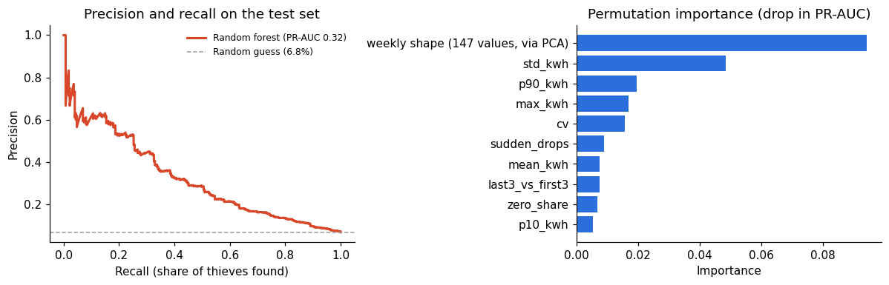

# Electricity theft detection from smart meter data

A practical data mining project on the SGCC dataset: getting the data, cleaning it, exploring it, reducing dimensions with PCA, and justifying one classifier (a random forest) for ranking customers by theft risk.

## Data

The SGCC dataset (State Grid Corporation of China) has daily kWh readings for 42,372 customers from 1 January 2014 to 31 October 2016. 3,615 of them (8.5%) are labelled as thieves. It was released with Zheng et al. (2018), *Wide and Deep Convolutional Neural Networks for Electricity-Theft Detection to Secure Smart Grids*, IEEE Transactions on Industrial Informatics 14(4), and is shared at [henryRDlab/ElectricityTheftDetection](https://github.com/henryRDlab/ElectricityTheftDetection).

On first run the notebook downloads the three zip parts (about 52 MB) into `data/sgcc/`. It then extracts the 175 MB CSV directly and checks its checksum, because standard unzip tools fail on this split archive. The data is not stored in this repository.

## Key findings

- **The missing values leak the label.** A classifier trained only on *which days are missing* reaches ROC-AUC 0.85, using no consumption data at all. The model is therefore never given the missing pattern, and gaps are filled before features are built. A final check shows that skipping gaps instead of filling them gives the same score (0.807 vs 0.809), so the model learns from consumption.
- **Cleaning:**
    - keep customers with at most 10% missing (20,142 customers, 6.8% thieves);
    - fill gaps by straight-line interpolation;
    - cap readings above the mean plus 3 standard deviations;
    - shuffle the rows, because the file lists all thieves first.
- **PCA:** on 147 weekly shape values, 110 components are needed for 90% of the variance, so the shape data is noisy. The first 20 components are used. The classes overlap completely in 2-D.
- **Model comparison** (5-fold CV, 12 behaviour features plus 20 PCA components):

| Model | ROC-AUC | PR-AUC | Precision in top 5% |
|---|---|---|---|
| Random guess | 0.50 | 0.07 | 0.07 |
| Logistic regression | 0.74 | 0.23 | 0.29 |
| **Random forest** | **0.80** | **0.31** | **0.39** |
| Gradient boosting | 0.79 | 0.31 | 0.39 |

- **Held-out test set** (4,029 customers): ROC-AUC 0.80 and PR-AUC 0.32. Flagging the top 5% (201 customers) finds 88 thieves, so 43.8% of visits find a thief against 6.8% for random visits.




## Run it

```bash
python -m venv .venv
source .venv/bin/activate
pip install -r requirements.txt
jupyter nbconvert --to notebook --execute electricity_theft.ipynb   # or open it in VS Code / Jupyter
```

Running the whole notebook takes about a minute on a recent laptop, after the download.
