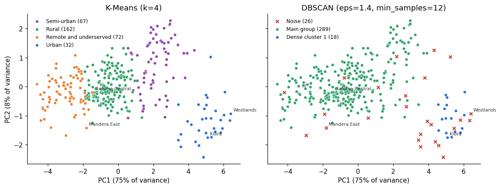

# K-Means vs DBSCAN on Kenyan sub-county demographics

Two clustering algorithms are compared on 333 Kenyan sub-counties using the 2019 Kenya Population and Housing Census.

## Data

The census tables come from the [rKenyaCensus](https://github.com/Shelmith-Kariuki/rKenyaCensus) repository (MIT licence), which packages the KNBS 2019 census reports. The notebook downloads the eight tables it needs (about 340 KB) into `data/` on first run.

Eight indicators are built for each sub-county:

- population density (log scale);
- average household size;
- share of people under 15;
- share of households lit by mains electricity;
- share of households with piped water;
- share of households cooking with firewood;
- share of people using the internet;
- share of people owning a mobile phone.

Twelve units are removed: eleven forests and national parks with fewer than 1,000 households, and Mau Forest, which has no household count.

## Results

| | K-Means (k = 4) | DBSCAN (eps = 1.4, min_samples = 12) |
|---|---|---|
| Clusters | 4 (32, 67, 162, 72) | 2 (289, 18) + 26 noise |
| Silhouette | 0.386 | 0.518 on clustered points, 0.364 with noise as a group |
| Davies–Bouldin | 0.916 | 0.516 on clustered points |
| Calinski–Harabasz | 328 | 123 |
| Stability (mean ARI, 50 × 90% subsamples) | 0.966 | 0.932 |

- **Choosing k:** k = 2 has the highest silhouette (0.466) but only splits town from countryside. The elbow is at k = 4, which also scores slightly better than k = 3.
- **Runtime:** K-Means takes longer because it is restarted 20 times. Exact times depend on the machine.
- **Agreement:** the two results agree poorly (ARI 0.20).
- **K-Means** gives urban, semi-urban, rural, and remote and underserved sub-counties. The remote group is mostly in the arid north and north-east.
- **DBSCAN** sees one connected spread. It separates a dense cluster of suburbs in Nairobi, Kiambu, Nakuru, Kajiado and Kisumu, and flags unusual places as noise, such as all six Mombasa sub-counties, Westlands and Mathare.




## Run it

```bash
python -m venv .venv
source .venv/bin/activate
pip install -r requirements.txt
jupyter nbconvert --to notebook --execute kenya_clustering.ipynb   # or open it in VS Code / Jupyter
```
