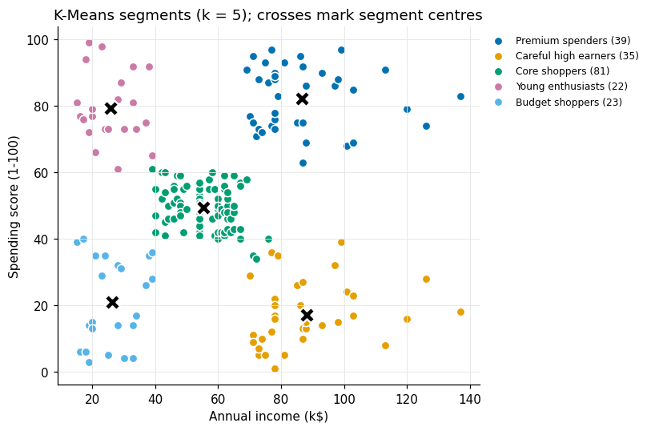
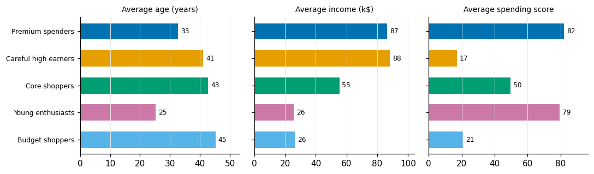

# Customer segmentation with K-Means (Mall Customers data)

K-Means clustering groups 200 shoppers into segments, and the segments are turned into recommendations for a Kenyan retail chain.

## Data

[Mall Customer Segmentation Data](https://www.kaggle.com/datasets/vjchoudhary7/customer-segmentation-tutorial-in-python) on Kaggle (Vijay Choudhary, from Udemy's Machine Learning A-Z course). The notebook downloads it with `kagglehub`, which needs no Kaggle account for public data, and copies it into `data/`.

The Kaggle page says the data set was "created only for the learning purpose", so the customers are not real and not Kenyan. Each row has gender, age, annual income (thousands of US dollars) and a spending score from 1 to 100.

## Method

- **Features:** annual income and spending score, scaled to mean 0 and standard deviation 1. Gender is left out on purpose. Age is added later as a check.
- **Choosing k:** K-Means for k = 2 to 10, compared by the elbow, silhouette, Davies–Bouldin, Calinski–Harabasz and stability (adjusted Rand index over 50 random 90 % samples).
- **Checks:** Ward hierarchical clustering, a chi-square test of gender against segment, a refit with age, and the same model in Spark MLlib.

## Results

k = 5 is best: silhouette 0.555, Davies–Bouldin 0.572, stability 0.992.

| Segment | Customers | Avg. age | Avg. income (k$) | Avg. spending score |
|---|---|---|---|---|
| Premium spenders | 39 | 33 | 86 | 82 |
| Careful high earners | 35 | 41 | 88 | 17 |
| Core shoppers | 81 | 43 | 55 | 50 |
| Young enthusiasts | 22 | 25 | 26 | 79 |
| Budget shoppers | 23 | 45 | 26 | 21 |

- **Ward clustering** agrees with K-Means (ARI 0.942).
- **Gender** does not differ between segments (chi-square p = 0.69).
- **With age** the best k is 6. The core shoppers split into a younger and an older group, and the other segments barely change.
- **Spark MLlib** K-Means finds the same five segments (ARI 1.000).





## Run it

```bash
python -m venv .venv
source .venv/bin/activate
pip install -r requirements.txt
jupyter nbconvert --to notebook --execute customer_segmentation.ipynb   # or open it in VS Code / Jupyter
```

Section 8 (Spark) needs Java 17 or 21. Without PySpark or Java it is skipped and the rest still runs.
