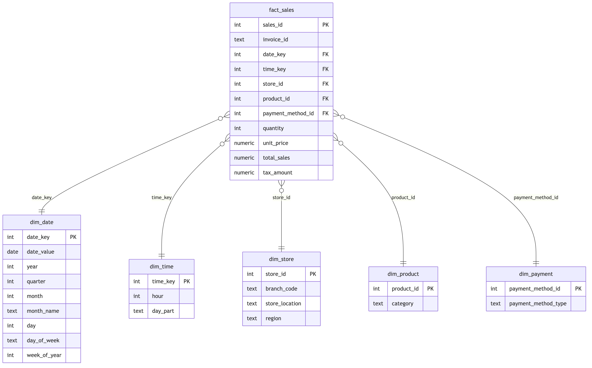
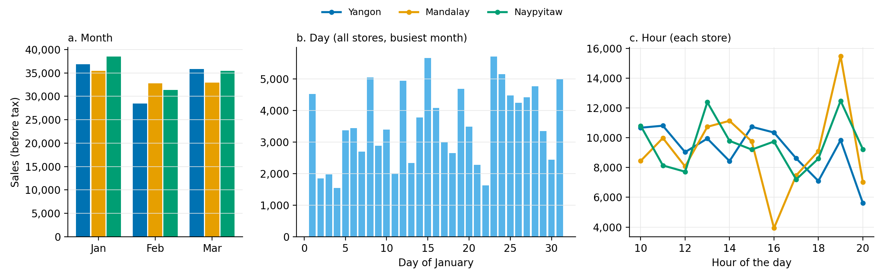

# OLAP on supermarket sales with a star schema in PostgreSQL

A small data warehouse for a supermarket chain, built and queried with the four OLAP operations: **slice and dice, drill-down, roll-up and pivot**. It follows the practical activity on OLAP in Module 5 (Data Reduction and OLAP).

## Data

[Supermarket Sales](https://www.kaggle.com/datasets/shandeep777/supermarket-dataset) on Kaggle, first shared by Aung Pyae. It has 1,000 sales from three branches of a supermarket chain in Myanmar (Yangon, Mandalay, Naypyitaw), 1 January to 30 March 2019, with date, time, product line, unit price, quantity and payment method. The notebook downloads it with `kagglehub` into a git-ignored `data/` folder. No Kaggle account is needed.

## What the notebook does

1. Checks the data: no gaps, no repeated invoices, and price times quantity always equals the pre-tax amount.
2. Builds a star schema (`sql/01_schema.sql`): `fact_sales` with `dim_date`, `dim_time`, `dim_store`, `dim_product` and `dim_payment`.

   
3. Runs the ETL (`sql/02_etl.sql`): `COPY` into a staging table, clean, fill the dimensions, then the fact table. The warehouse totals (1,000 sales, 5,510 units, 307,587.38 before tax) match the CSV exactly.
4. Runs the OLAP queries (`sql/03_olap_queries.sql`), including `GROUP BY ROLLUP`, `GROUP BY CUBE` and pivots with `SUM ... FILTER`.
5. Rebuilds the pivots with `pandas.pivot_table` (the spreadsheet approach) and checks they match the SQL.
6. Draws the figures and writes `results_olap.json`.

## Main findings

- **Slice (store = Yangon):** home and lifestyle is 21.1% of Yangon sales against 16.7% for the chain. Health and beauty is only 11.9% against 15.2%.
- **Drill-down:** February is the weakest month in every store, even per trading day. Saturday is the best weekday. Mandalay and Naypyitaw peak at 19:00, while Yangon's sales are spread through the day.
- **Roll-up:** sales fell 16.4% from January to February and rose 12.6% in March.
- **Pivot:** the best category changes each month. It was sports and travel in January, food and beverages in February, and home and lifestyle in March.



## Running it

```bash
docker compose up -d                      # PostgreSQL 17 on port 5433 (local test credentials)
python -m venv .venv && source .venv/bin/activate
pip install -r requirements.txt
jupyter nbconvert --to notebook --execute olap_mini_project.ipynb   # or open it in Jupyter / VS Code
```

To use another PostgreSQL server, set `PGHOST`, `PGPORT`, `PGUSER`, `PGPASSWORD` and `PGDATABASE`. The notebook creates the `supermarket_dw` database if it does not exist.

`figures/star_schema.png` is rendered from `star_schema.mmd` with the Mermaid CLI (`mmdc -i star_schema.mmd -o figures/star_schema.png -b white -s 3 -w 1400`).
